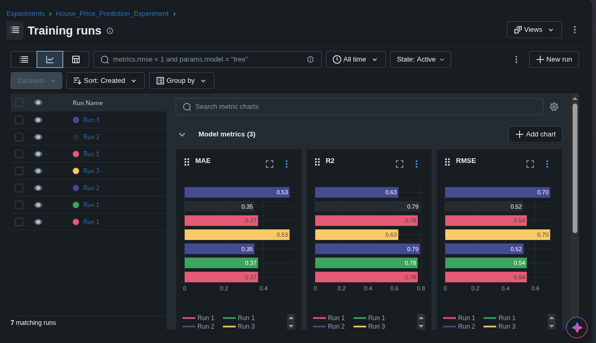

# ML Experiment Tracking with MLflow

## 1. Task Description
This project demonstrates how to use MLflow to track and compare machine learning experiments for a House Price Prediction problem. A Gradient Boosting Regressor is trained on the California Housing dataset using three different sets of hyperparameters to identify the best-performing model based on evaluation metrics.

## 2. How to Run the Project
1. Create a virtual environment and install dependencies: `pip install -r requirements.txt`
2. Execute the training script: `python train.py`
3. Launch the MLflow UI to view results: `mlflow ui`
4. Open `http://127.0.0.1:5000` in your web browser.

## 3. MLflow Experiment Results

## 4. Comparison Table
| Experiment | Max Depth | Learning Rate | RMSE | MAE | $R^2$ |
| :--- | :--- | :--- | :--- | :--- | :--- |
| Run 1 | 3 | 0.1 | 0.54 | 0.37 | 0.78 |
| Run 2 | 5 | 0.05 | 0.52 | 0.35 | 0.79 |
| Run 3 | 7 | 0.01 | 0.70 | 0.53 | 0.63 |

## 5. Selected Best Model
**Run 2** is the selected best model.

## 6. Explanation
Based on the assignment's requirement to use RMSE as the primary metric for model selection, Run 2 achieved the lowest score of 0.52. Additionally, Run 2 yielded the lowest Mean Absolute Error (0.35) and the highest $R^2$ score (0.79), demonstrating the best overall predictive performance among the three configurations tested.
